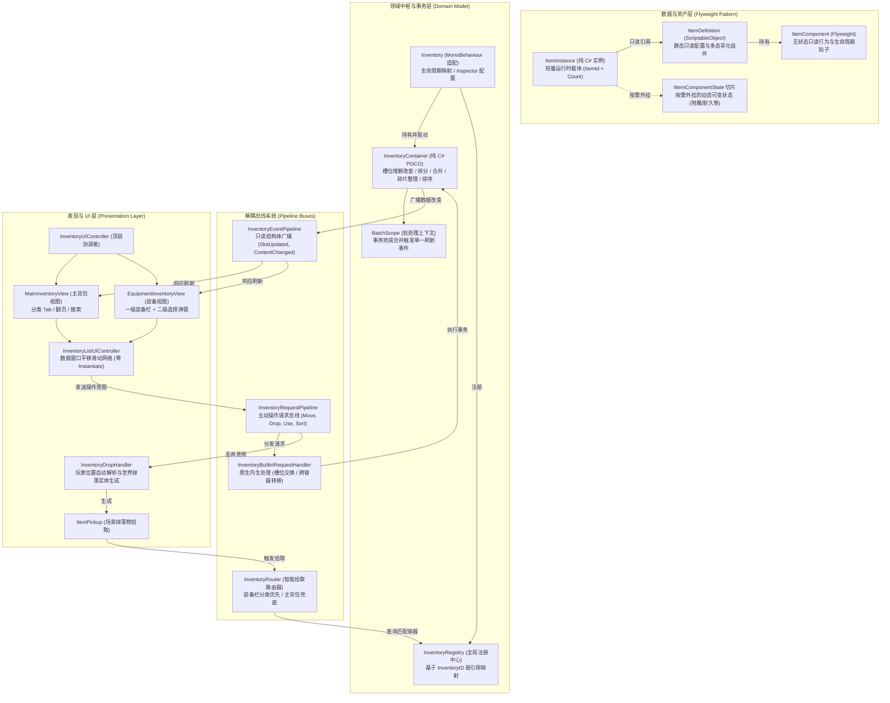

# CwcInventoryEngine - 高性能享元背包与装备系统引擎

[](https://unity.com/)
[-blue.svg)](LICENSE)
[](https://github.com/CwcbbChao/CwcInventoryEngine/pulls)
[](#性能与设计指标)

**简体中文** | [English](README_EN.md)

---

## 插件简介

`CwcInventoryEngine` 是一个专为 Unity 中大型游戏（RPG / 生存 / 探索 / ACT）打造的**轻量级、高性能、零 GC、纯领域驱动的享元背包、装备与容器系统引擎**。

### 为什么选择 CwcInventoryEngine？

传统 Unity 背包系统通常面临以下痛点：
1. **内存与 GC 膨胀**：每个道具实例均分配独立对象或大量冗余字段，海量道具进出背包导致频繁的垃圾回收（GC Alloc）。
2. **UI 与逻辑深耦合**：UI 界面直接强引用玩家实体或背包 GameObject，换界面或换场景时极易引发空引用异常。
3. **掉落与拾取死板**：掉落物硬编码塞入单一主背包，无法自动识别装备栏优先穿戴，逻辑难以扩展。
4. **存档脆弱易损坏**：脚本类名微调或命名空间重构后，历史旧存档直接反序列化失效崩溃。

`CwcInventoryEngine` 彻底解决了上述问题：
- **享元模式 (Flyweight Pattern)**：数据只读共享，动态修改外挂切片（Slices），白板物品 0 内存多余分配，O(1) 极速堆叠判定；
- **纯 C# 领域实体与表现解耦**：核心容器为 POCO 纯 C# 类，脱离场景运行，支持极速单元测试；
- **双总线架构 (Event & Request Pipeline)**：单向事件广播与主动操作意图总线分离，UI 与业务完全解耦；
- **数据窗口平移 UI**：静态有限单元格复用，杜绝动态生成 Prefab 与 Canvas 网格重建开销。

---

## 核心设计特性

1. **享元模板与动态切片隔离 (Flyweight & State Slicing)**
   - `ItemDefinition` (ScriptableObject) 仅存储只读静态数据与多态行为组件（通过 `[SerializeReference]` 序列化）；
   - `ItemInstance` 运行时纯 C# 实例仅持有 `ItemId`（16 字节只读 Guid 值类型结构体）、`Definition` 引用和 `StackCount`；
   - 动态修改数据（如耐久度、强化等级、附魔词条）通过 `IItemComponentState` 切片按需挂载。未修改的白板物品实现 0 额外切片分配与存盘零冗余。
2. **纯 C# 领域模型 (Domain-Driven Design)**
   - `InventoryContainer` 是纯 C# 领域中枢，负责处理放入、取出、拆分、跨容器转移、原子交换（Swap）、碎片整理（Defragment）与排序；
   - 完全脱离 Unity 场景与 `MonoBehaviour` 约束，可在不启动 Unity 播放模式的情况下执行毫秒级纯逻辑单元测试。
3. **批处理事务作用域 (BatchScope)**
   - 跨容器转移全部物品、快捷堆叠补充、规则排序或碎片整理时，使用 `using (container.BatchScope())` 开启批处理事务；
   - 事务期间压制所有槽位刷新事件，在作用域离开时仅对外触发一次脏槽位合并广播，彻底消除 UI 频闪与重绘掉帧。
4. **双总线管线与全局解耦注册中心 (Decoupled Pipelines)**
   - **事件管线 (`InventoryEventPipeline`)**：基于 `in InventoryEvent` 只读结构体传递状态变更，内置防 Unity 假 Null 对象的安全过滤；
   - **请求管线 (`InventoryRequestPipeline`)**：UI 发起丢弃、使用、移动、拆分等操作时，只需发送强类型意图请求，无需引用具体目标实体；
   - **内置原生处理器 (`InventoryBuiltinRequestHandler`)**：开箱即用自动监听并执行容器内与跨容器移动、交换、排序和碎片整理；
   - **全局注册中心 (`InventoryRegistry`)**：基于唯一字符串 ID 解耦查找，通过 SubsystemRegistration 特性原生支持 Unity 禁用域重载（Disable Domain Reload）。
5. **智能拾取路由器 (`InventoryRouter`)**
   - 拾取掉落物时，路由器自动遍历所有已注册的可用库存；
   - 优先匹配声明了专用槽位限制的装备栏/快捷栏（拾取自动穿戴），次级放入主背包；支持通过 `IInventoryRoutePolicy` 注入自定义路由算法。
6. **0-GC 判别联合属性评估与通用查询 (Zero-Boxing Query)**
   - `ItemPropertyValue` 采用只读结构体（Discriminated Union）实现，覆盖 Int, Float, String, Bool, Object 等类型，彻底消除排序与筛选过程中的基本类型装箱（Boxing）；
   - `InventoryQuerySpec` 聚合筛选规则（`IItemRule`）与排序 Key，驱动 UI 列表实现高性能动态筛选与排序。
7. **数据窗口平移 UI 控制器 (Data-Window Sliding UI)**
   - `InventoryListUIController` 采用固定数量的静态 UI 槽位复用，通过数据窗口平移支持 1D 列表与 2D 矩阵网格，规避动态 Instantiate/Destroy 开销；
   - `InventoryListItemUI` 控制子节点显隐采用 `CanvasGroup` Alpha 与 Raycast 切换，严禁调用 `GameObject.SetActive`，杜绝 Canvas 顶点网格 Rebuild；
   - `EquipmentInventoryView` 原生内置二级装备选择弹窗，复用装备槽 `CanAccept` 规则实现点击即开即选即换。
8. **存盘自治与版本重构容错 (Autonomous Persistence)**
   - 存盘读盘完全由享元组件自治负责（`TryExportState` / `ImportState`）；
   - `ItemSaveData` 还原时支持类全名精确匹配、类短名匹配以及 `[ItemComponentAlias]` 历史别名声明，从容应对代码重构、类重命名与命名空间迁移。
9. **专属 Inspector 编辑器与调试套件 (Editor Tooling)**
   - `ItemDefinitionEditor` 彻底消除 Unity 原生 `[SerializeReference]` 刺眼的蓝色整块选中高亮，支持扁平化条带 Header、搜索下拉树（AdvancedDropdown）以及组件单体/全局复制粘贴；
   - `InventoryComponentEditor` 在 Inspector 呈现只读槽位调试列表，支持空槽位过滤与运行时一键清空背包。

---

## 架构拓扑总览



---

## 安装方式

### 方式 A：通过 Unity Package Manager (Git URL 推荐)
1. 打开 Unity 编辑器菜单栏：`Window` -> `Package Manager`。
2. 点击左上角 `+` 号按钮 -> 选择 **Add package from git URL...**。
3. 输入仓库地址：
   ```text
   https://github.com/CwcbbChao/CwcInventoryEngine.git
   ```
4. 点击 **Add** 即可完成自动安装。

### 方式 B：通过 OpenUPM 安装 (CLI)
```bash
openupm add com.cwcbb.cwcinventoryengine
```

### 方式 C：直接拷贝源码
将当前仓库源码复制到工程的 `Assets/CwcPlugins/CwcInventoryEngine/` 目录下即可。

---

## 快速上手 (Quick Start)

### 1. 创建静态物品定义 (ItemDefinition)
1. 在 Project 窗口右键菜单选择：`Create` -> `Cwc` -> `Inventory` -> `Item Definition`。
2. 在 Inspector 界面中设置 `Max Stack`（例如药水设为 99，不可堆叠的装备设为 1）。
3. 点击 **添加组件** 按钮，在弹出的搜索树中直接添加组件（如 `ItemDisplayComponent`、`ItemDropComponent` 等）。

### 2. 挂载与初始化背包组件 (Inventory)
为玩家或宝箱 GameObject 挂载 `Inventory` 组件：
```csharp
using UnityEngine;
using Cwc.InventoryEngine;

public class PlayerInventorySetup : MonoBehaviour
{
    [SerializeField] private Inventory _inventory;

    private void Start()
    {
        // 若勾选了 AutoInitialize，组件在 Awake 中已自动完成初始化与全局注册
        Debug.Log($"背包初始化完成，当前容量: {_inventory.Capacity}");
    }
}
```

### 3. 纯代码执行容器事务 (0-GC 容器操作)
```csharp
using UnityEngine;
using Cwc.InventoryEngine;

public class InventoryOperationsDemo : MonoBehaviour
{
    public void TestContainerTransactions(Inventory inventory, ItemDefinition swordDef, ItemDefinition potionDef)
    {
        InventoryContainer container = inventory.Container;

        // 1. 批量添加道具 (使用 BatchScope 批处理上下文)
        using (container.BatchScope())
        {
            var sword = swordDef.CreateInstance(1);
            container.TryAddItem(sword, out _);

            var potions = potionDef.CreateInstance(20);
            container.TryAddItem(potions, out _);
        } // 离开作用域时统一刷出一次 UI 更新事件

        // 2. 容器碎片整理 (消除空隙并合并未满堆叠)
        container.Defragment();

        // 3. 跨槽位移动或原子交换
        container.SwapOrMergeSlots(fromSlotIndex: 0, toSlotIndex: 1);

        // 4. 从指定槽位安全取出物品 (转移所有权，不销毁实例)
        if (container.TryTakeSlotItem(slotIndex: 1, count: 5, out ItemInstance takenPotions))
        {
            Debug.Log($"已成功取出 5 瓶药水，实例 ID: {takenPotions.InstanceID}");
        }
    }
}
```

### 4. 派生自定义享元组件与动态切片
演示如何实现一个支持动态耐久度且影响堆叠判定的装备组件：

```csharp
using System;
using UnityEngine;
using Cwc.InventoryEngine;

// 1. 定义动态可变状态切片
public class DurabilityState : IItemComponentState
{
    public int CurrentDurability = 100;

    public void Reset() => CurrentDurability = 100;

    public IItemComponentState Clone() => new DurabilityState { CurrentDurability = CurrentDurability };

    // 堆叠判定：耐久度完全相同的物品才允许合并堆叠
    public bool CanStackWith(IItemComponentState other)
    {
        return other is DurabilityState otherState && CurrentDurability == otherState.CurrentDurability;
    }
}

// 2. 定义享元组件基类
[Serializable]
[ItemComponentPath("装备系统/耐久度 Durability")]
public class DurabilityComponent : ItemComponent
{
    [SerializeField] private int _maxDurability = 100;

    public int GetCurrentDurability(ItemInstance instance)
    {
        if (instance != null && instance.TryGetState<DurabilityState>(out var state))
        {
            return state.CurrentDurability;
        }
        return _maxDurability;
    }

    public void DamageDurability(ItemInstance instance, int amount)
    {
        if (instance == null) return;
        var state = instance.GetState<DurabilityState>(); // 按需外挂动态切片
        state.CurrentDurability = Mathf.Max(0, state.CurrentDurability - amount);
    }

    // 存盘自治：仅当耐久度受损时才导出 JSON 增量
    public override bool TryExportState(ItemInstance instance, out string jsonData)
    {
        if (instance != null && instance.TryGetState<DurabilityState>(out var state))
        {
            if (state.CurrentDurability != _maxDurability)
            {
                jsonData = $"{state.CurrentDurability}";
                return true;
            }
        }
        jsonData = null;
        return false;
    }

    // 读盘自治：还原增量状态
    public override void ImportState(ItemInstance instance, string jsonData)
    {
        if (int.TryParse(jsonData, out int durability))
        {
            var state = instance.GetState<DurabilityState>();
            state.CurrentDurability = durability;
        }
    }
}
```

### 5. 通过请求总线解耦交互 (UI 与逻辑分离)
UI 界面或按键响应无需获取复杂的业务对象，直接发送意图请求：

```csharp
using Cwc.InventoryEngine;

public class PlayerActionExample
{
    // 丢弃选中槽位的道具
    public void DropItem(string inventoryId, int slotIndex)
    {
        InventoryRequestPipeline.Send(new InventoryDropRequest(inventoryId, slotIndex, count: 1));
    }

    // 将装备槽的道具卸下到主背包的任意可用空栏
    public void UnequipToMainInventory(int equipmentSlotIndex)
    {
        InventoryRequestPipeline.Send(InventoryMoveRequest.ToAnySlot(
            sourceInventoryId: "PlayerEquipment",
            sourceSlotIndex: equipmentSlotIndex,
            targetInventoryId: "MainInventory"
        ));
    }
}
```

### 6. 一行代码 JSON 持久化与读盘还原
系统支持存盘解耦，通过实现 `IItemAssetResolver` 即可自由集成 Addressables、Resources 或静态配置表：

```csharp
using UnityEngine;
using Cwc.InventoryEngine;

public class SimpleSaveLoadDemo : MonoBehaviour, IItemAssetResolver
{
    [SerializeField] private Inventory _inventory;
    [SerializeField] private ItemDefinition[] _allItemDefinitions;

    // 1. IItemAssetResolver 契约实现
    public string GetAssetKey(ItemDefinition definition) => definition != null ? definition.name : string.Empty;

    public ItemDefinition ResolveDefinition(string assetKey)
    {
        return System.Array.Find(_allItemDefinitions, d => d.name == assetKey);
    }

    // 2. 导出 JSON 存档
    public void SaveGame()
    {
        string json = _inventory.SaveToJson(this);
        PlayerPrefs.SetString("InventorySaveData", json);
        PlayerPrefs.Save();
        Debug.Log("背包存档成功！");
    }

    // 3. 从 JSON 还原背包
    public void LoadGame()
    {
        string json = PlayerPrefs.GetString("InventorySaveData", string.Empty);
        if (!string.IsNullOrEmpty(json))
        {
            _inventory.LoadFromJson(json, this);
            Debug.Log("背包数据已成功恢复！");
        }
    }
}
```

---

## 性能与设计指标

| 指标项 | 表现与设计说明 |
| :--- | :--- |
| **白板物品内存分配** | **0 字节多余堆内存**。纯白板物品的 `_runtimeStates` 字典为 `null`，只持有指向静态 ScriptableObject 的单例引用。 |
| **属性提取与排序 GC** | **0 GC 分配**。`ItemPropertyValue` 判别联合体消除基础数值（Int/Float/Bool/String）装箱开销。 |
| **滑动列表渲染 GC** | **0 运行时 Instantiate**。通过 `InventoryListUIController` 数据窗口平移复用静态有限节点。 |
| **UI 显隐开销** | **0 Canvas Rebuild**。使用 `CanvasGroup` Alpha 与 Raycast 控制元素可见性，避免调用 `SetActive` 引发网格重建。 |
| **批处理事件合并** | 支持 `BatchScope` 作用域，跨容器全量转移或排序时仅在作用域结束触发一次刷新广播。 |
| **Unity 编辑器播放优化** | 核心静态类配置了 `SubsystemRegistration`，原生完美兼容 **Disable Domain Reload**。 |

---

## 目录结构说明

```text
Assets/CwcPlugins/CwcInventoryEngine/
├── Demo/                  # 独立功能演示模块 (含可交互测试场景、配置资产与测试控制器，可随时安全移除)
├── Editor/                # 编辑器专属扩展 (高级 SerializeReference 绘制器、只读 Inspector 槽位调试视图)
├── Runtime/
│   ├── Components/        # 核心内置组件 (ItemDisplay, ItemDrop, ItemPickup, InventoryRouter 等)
│   ├── Core/              # 核心领域实体 (ItemDefinition, ItemInstance, InventoryContainer, Pipelines 等)
│   ├── Interfaces/        # 规范接口定义 (IUsable, IEquippable, IItemFilter, IReadOnlyInventoryContainer 等)
│   ├── Query/             # 0-GC 判别联合属性评估器与统一查询规格系统
│   ├── Save/              # 存盘与读盘标准 DTO 数据契约
│   └── UI/                # 开箱即用的 UGUI + TextMeshPro 控制器与视图体系
└── Tests/                 # NUnit 单元测试套件 (覆盖享元架构、切片隔离、存盘自治等核心逻辑)
```

---

## 许可证 (License)

本项目采用 [CWC TOOLS PUBLIC LICENSE](LICENSE) 授权许可。
对最终作品（商业游戏、互动应用等）免费开放使用，禁止作为独立开发工具包在第三方资产市场二次转售。详情请参阅 [LICENSE](LICENSE)。
