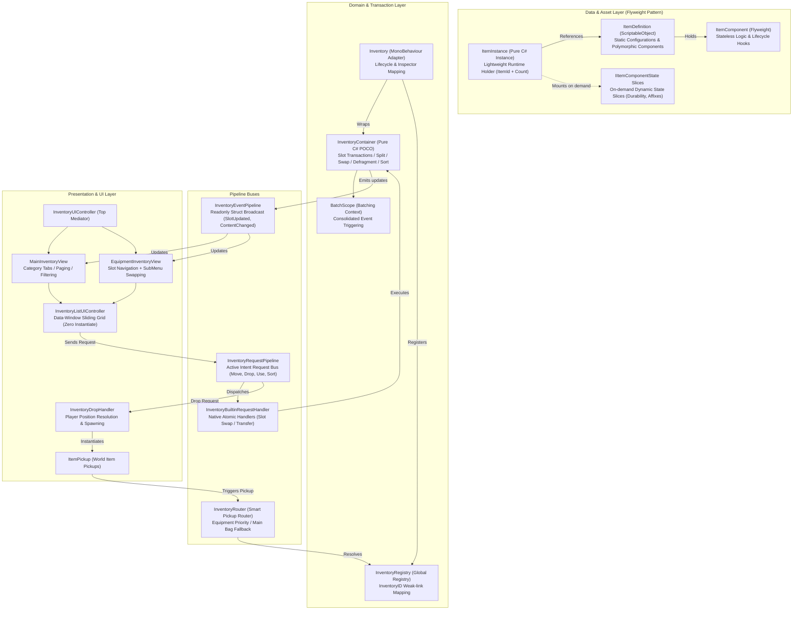

# CwcInventoryEngine - High-Performance Flyweight Inventory & Equipment Engine

[](https://unity.com/)
[-blue.svg)](LICENSE)
[](https://github.com/CwcbbChao/CwcInventoryEngine/pulls)
[](#performance--design-metrics)

[简体中文](README.md) | **English**

---

## Introduction

`CwcInventoryEngine` is a **lightweight, high-performance, 0-GC, pure domain-driven flyweight inventory, equipment, and storage engine** designed for modern Unity games (RPG / Survival / Action / Exploration).

### Why CwcInventoryEngine?

Traditional Unity inventory systems frequently suffer from major engineering pitfalls:
1. **Memory & GC Bloat**: Each item instance allocates distinct GameObjects or sprawling class fields, causing severe Garbage Collection spikes as items flow through inventories.
2. **Coupled UI & Domain**: UI panels tightly bind to player GameObjects, causing missing reference exceptions upon scene transitions or interface swapping.
3. **Inflexible Routing**: World drop pickups are hard-coded to a single player bag, unable to prioritize specialized equipment slots or dedicated category containers.
4. **Fragile Save Persistence**: Slight class renames or namespace refactors break legacy save files upon deserialization.

`CwcInventoryEngine` solves these problems from the ground up:
- **Flyweight Pattern & Dynamic Slices**: Immutable asset templates with on-demand runtime mutable slices. Plain items cost zero extra heap allocation and feature O(1) fast-path stacking.
- **Pure C# Domain Architecture**: `InventoryContainer` operates as a POCO domain model completely isolated from `MonoBehaviour`, enabling sub-millisecond unit tests.
- **Dual-Bus Pipelines**: One-way state broadcast (`EventPipeline`) separated from active gameplay intent dispatch (`RequestPipeline`).
- **Data-Window Sliding UI**: Fixed slot reuse avoiding runtime Instantiate/Destroy allocations and canvas mesh rebuilds.

---

## Key Features

1. **Flyweight Template & Dynamic State Slicing**
   - `ItemDefinition` (ScriptableObject) stores immutable static configuration and polymorphic components via `[SerializeReference]`.
   - `ItemInstance` runtime C# instance only holds `ItemId` (16-byte readonly Guid value struct), definition reference, and `StackCount`.
   - Runtime modifications (e.g. durability, enhancement, affixes) attach as `IItemComponentState` slices only when needed. Unmodified plain items cost 0 slice allocations.
2. **Pure C# Domain Model & Container Transactions**
   - `InventoryContainer` acts as the domain transaction hub, managing additions, removals, splits, cross-container transfers, atomic slot swaps, defragmentation, and sorting.
   - Decoupled from `MonoBehaviour`, allowing instant unit tests without entering Unity Play Mode.
3. **Transaction Batching (`BatchScope`)**
   - Multi-item transfers, sorting, or quick-stacking execute within `using (container.BatchScope())`.
   - Suppresses intermediate slot events and fires a single consolidated update upon scope exit, preventing UI stutter.
4. **Dual-Bus Pipelines & Global Registry**
   - **Event Pipeline (`InventoryEventPipeline`)**: Broadcasts state changes via `in InventoryEvent` readonly structs with dead-target validation against destroyed Unity objects.
   - **Request Pipeline (`InventoryRequestPipeline`)**: Dispatches strongly-typed intent requests (`Drop`, `Use`, `Move`, `Split`, `Sort`, `Defragment`) without coupling UI to target entities.
   - **Builtin Request Handler (`InventoryBuiltinRequestHandler`)**: Automatically executes container data transactions out of the box.
   - **Global Registry (`InventoryRegistry`)**: Decouples containers by string ID with SubsystemRegistration reset support for Disable Domain Reload.
5. **Smart Pickup Router (`InventoryRouter`)**
   - When picking up world items, the router automatically resolves registered routable inventories.
   - Prioritizes specialized category/equipment slots before falling back to main inventories. Extensible via `IInventoryRoutePolicy`.
6. **Zero-Boxing Discriminated Union Query System**
   - `ItemPropertyValue` value-type struct covers Int, Float, String, Bool, and Object types, eliminating boxing overhead during sorting and filtering.
   - `InventoryQuerySpec` unifies filter rules (`IItemRule`) and sort keys to drive high-performance UI filtering.
7. **Data-Window Sliding UI Architecture**
   - `InventoryListUIController` reuses fixed UI slot instances via data-window sliding for 1D lists and 2D matrix grids, eliminating runtime instantiation.
   - `InventoryListItemUI` controls element visibility via `CanvasGroup` alpha and raycast blocking rather than `GameObject.SetActive`, avoiding canvas mesh rebuilds.
   - `EquipmentInventoryView` features an integrated sub-menu popup that dynamically applies equipment slot `CanAccept` rules.
8. **Autonomous Persistence & Refactoring Safeguards**
   - Each component independently manages serialization via `TryExportState` and `ImportState`.
   - `ItemSaveData` supports full type matching, short name matching, and `[ItemComponentAlias]` attributes to survive class renames and namespace changes.
9. **Polished Editor Tooling**
   - `ItemDefinitionEditor` removes Unity's native `[SerializeReference]` blue box highlights, featuring flat headers, `AdvancedDropdown` search trees, and component copy-paste.
   - `InventoryComponentEditor` provides a real-time readonly inspector slot debugger.

---

## Architecture Overview



---

## Installation

### Method A: Unity Package Manager (Git URL Recommended)
1. Open Unity Editor: `Window` -> `Package Manager`.
2. Click `+` -> Select **Add package from git URL...**.
3. Enter repository URL:
   ```text
   https://github.com/CwcbbChao/CwcInventoryEngine.git
   ```
4. Click **Add**.

### Method B: OpenUPM CLI
```bash
openupm add com.cwcbb.cwcinventoryengine
```

### Method C: Direct Source Code
Copy the repository into your Unity project under `Assets/CwcPlugins/CwcInventoryEngine/`.

---

## Quick Start

### 1. Create Static Item Definitions
1. Right-click in the Project window: `Create` -> `Cwc` -> `Inventory` -> `Item Definition`.
2. In Inspector, set `Max Stack` (e.g. 99 for potions, 1 for unstackable gear).
3. Click **Add Component** and select desired components from the search tree (e.g., `ItemDisplayComponent`, `ItemDropComponent`).

### 2. Attach Inventory Component
Attach `Inventory` to your Player or Chest GameObject:
```csharp
using UnityEngine;
using Cwc.InventoryEngine;

public class PlayerInventorySetup : MonoBehaviour
{
    [SerializeField] private Inventory _inventory;

    private void Start()
    {
        // Automatically initialized & registered to InventoryRegistry on Awake
        Debug.Log($"Inventory initialized with capacity: {_inventory.Capacity}");
    }
}
```

### 3. Pure Code Container Transactions (0-GC)
```csharp
using UnityEngine;
using Cwc.InventoryEngine;

public class InventoryOperationsDemo : MonoBehaviour
{
    public void TestContainerTransactions(Inventory inventory, ItemDefinition swordDef, ItemDefinition potionDef)
    {
        InventoryContainer container = inventory.Container;

        // 1. Batch additions with BatchScope
        using (container.BatchScope())
        {
            var sword = swordDef.CreateInstance(1);
            container.TryAddItem(sword, out _);

            var potions = potionDef.CreateInstance(20);
            container.TryAddItem(potions, out _);
        } // Fires a single consolidated update event here

        // 2. Defragment container (eliminates gaps & merges partial stacks)
        container.Defragment();

        // 3. Swap or merge slots
        container.SwapOrMergeSlots(fromSlotIndex: 0, toSlotIndex: 1);

        // 4. Safely extract items (transfers ownership without destruction)
        if (container.TryTakeSlotItem(slotIndex: 1, count: 5, out ItemInstance takenPotions))
        {
            Debug.Log($"Extracted 5 potions with ID: {takenPotions.InstanceID}");
        }
    }
}
```

### 4. Create Custom Flyweight Component with Dynamic Slices
Demonstrating an equipment durability component affecting stacking behavior:

```csharp
using System;
using UnityEngine;
using Cwc.InventoryEngine;

// 1. Define mutable dynamic slice
public class DurabilityState : IItemComponentState
{
    public int CurrentDurability = 100;

    public void Reset() => CurrentDurability = 100;

    public IItemComponentState Clone() => new DurabilityState { CurrentDurability = CurrentDurability };

    // Stacking check: items only stack if durability matches exactly
    public bool CanStackWith(IItemComponentState other)
    {
        return other is DurabilityState otherState && CurrentDurability == otherState.CurrentDurability;
    }
}

// 2. Define flyweight component
[Serializable]
[ItemComponentPath("Equipment/Durability")]
public class DurabilityComponent : ItemComponent
{
    [SerializeField] private int _maxDurability = 100;

    public int GetCurrentDurability(ItemInstance instance)
    {
        if (instance != null && instance.TryGetState<DurabilityState>(out var state))
        {
            return state.CurrentDurability;
        }
        return _maxDurability;
    }

    public void DamageDurability(ItemInstance instance, int amount)
    {
        if (instance == null) return;
        var state = instance.GetState<DurabilityState>(); // Mounts slice on demand
        state.CurrentDurability = Mathf.Max(0, state.CurrentDurability - amount);
    }

    // Export autonomy: only serialize if damaged
    public override bool TryExportState(ItemInstance instance, out string jsonData)
    {
        if (instance != null && instance.TryGetState<DurabilityState>(out var state))
        {
            if (state.CurrentDurability != _maxDurability)
            {
                jsonData = $"{state.CurrentDurability}";
                return true;
            }
        }
        jsonData = null;
        return false;
    }

    // Import autonomy: restore state
    public override void ImportState(ItemInstance instance, string jsonData)
    {
        if (int.TryParse(jsonData, out int durability))
        {
            var state = instance.GetState<DurabilityState>();
            state.CurrentDurability = durability;
        }
    }
}
```

### 5. Decoupled Pipeline Requests
UI widgets do not need direct references to target entities; they simply dispatch requests:

```csharp
using Cwc.InventoryEngine;

public class PlayerActionExample
{
    // Drop item from slot
    public void DropItem(string inventoryId, int slotIndex)
    {
        InventoryRequestPipeline.Send(new InventoryDropRequest(inventoryId, slotIndex, count: 1));
    }

    // Unequip item to any available slot in main bag
    public void UnequipToMainInventory(int equipmentSlotIndex)
    {
        InventoryRequestPipeline.Send(InventoryMoveRequest.ToAnySlot(
            sourceInventoryId: "PlayerEquipment",
            sourceSlotIndex: equipmentSlotIndex,
            targetInventoryId: "MainInventory"
        ));
    }
}
```

### 6. One-Line JSON Save & Load Persistence
Implement `IItemAssetResolver` to connect with Addressables, Resources, or static tables:

```csharp
using UnityEngine;
using Cwc.InventoryEngine;

public class SimpleSaveLoadDemo : MonoBehaviour, IItemAssetResolver
{
    [SerializeField] private Inventory _inventory;
    [SerializeField] private ItemDefinition[] _allItemDefinitions;

    // 1. IItemAssetResolver Implementation
    public string GetAssetKey(ItemDefinition definition) => definition != null ? definition.name : string.Empty;

    public ItemDefinition ResolveDefinition(string assetKey)
    {
        return System.Array.Find(_allItemDefinitions, d => d.name == assetKey);
    }

    // 2. Export JSON
    public void SaveGame()
    {
        string json = _inventory.SaveToJson(this);
        PlayerPrefs.SetString("InventorySaveData", json);
        PlayerPrefs.Save();
        Debug.Log("Inventory saved!");
    }

    // 3. Restore JSON
    public void LoadGame()
    {
        string json = PlayerPrefs.GetString("InventorySaveData", string.Empty);
        if (!string.IsNullOrEmpty(json))
        {
            _inventory.LoadFromJson(json, this);
            Debug.Log("Inventory loaded!");
        }
    }
}
```

---

## Performance & Design Metrics

| Metric | Details & Design Strategy |
| :--- | :--- |
| **Plain Item Heap Cost** | **0 Extra Heap Bytes**. Plain unmodified items have a `null` `_runtimeStates` dictionary, referencing only the static ScriptableObject template. |
| **Property Query & Sorting GC** | **0 GC Allocations**. `ItemPropertyValue` discriminated union struct eliminates primitive boxing during sorting. |
| **Sliding List Rendering GC** | **0 Runtime Instantiate**. Fixed pool of UI items reused via data-window offset sliding in `InventoryListUIController`. |
| **UI Toggle Overhead** | **0 Canvas Mesh Rebuilds**. `CanvasGroup` alpha and raycast toggles replace `GameObject.SetActive`. |
| **Batch Event Merging** | `BatchScope` transaction context ensures single consolidated event dispatch upon exiting the scope. |
| **Domain Reload Optimization** | Static registries implement `SubsystemRegistration` resets, fully supporting **Disable Domain Reload**. |

---

## Directory Structure

```text
Assets/CwcPlugins/CwcInventoryEngine/
├── Demo/                  # Interactive demo module (Scene, configs, controllers; safe to remove)
├── Editor/                # Custom editors (SerializeReference drawer, Debug inspector view)
├── Runtime/
│   ├── Components/        # Built-in components (ItemDisplay, ItemDrop, ItemPickup, InventoryRouter)
│   ├── Core/              # Core domain entities (ItemDefinition, ItemInstance, InventoryContainer, Pipelines)
│   ├── Interfaces/        # Contracts (IUsable, IEquippable, IItemFilter, IReadOnlyInventoryContainer)
│   ├── Query/             # 0-GC discriminated union property evaluator & query spec
│   ├── Save/              # Standard DTO persistence serialization contracts
│   └── UI/                # Out-of-the-box UGUI + TextMeshPro controllers & views
└── Tests/                 # NUnit unit test suite (Flyweight zero-alloc, state slicing, save autonomy)
```

---

## License

This package is licensed under the [CWC TOOLS PUBLIC LICENSE](LICENSE).
Free for use in compiled end products (commercial games, simulations). Standalone redistribution or resale on asset marketplaces is strictly prohibited. See [LICENSE](LICENSE) for details.
